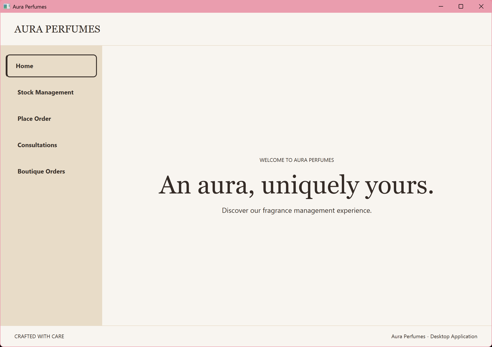
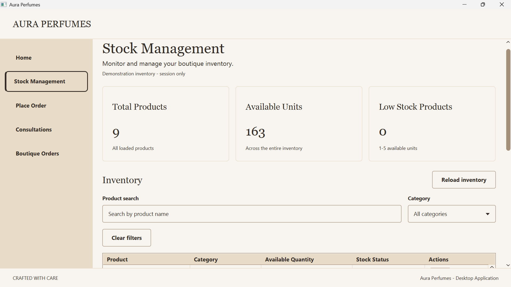
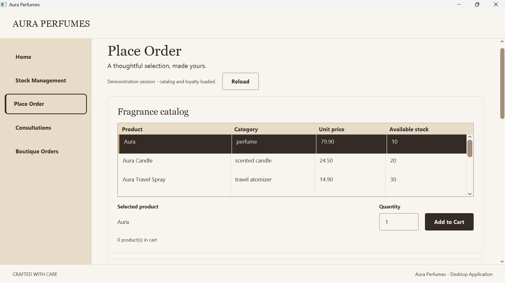
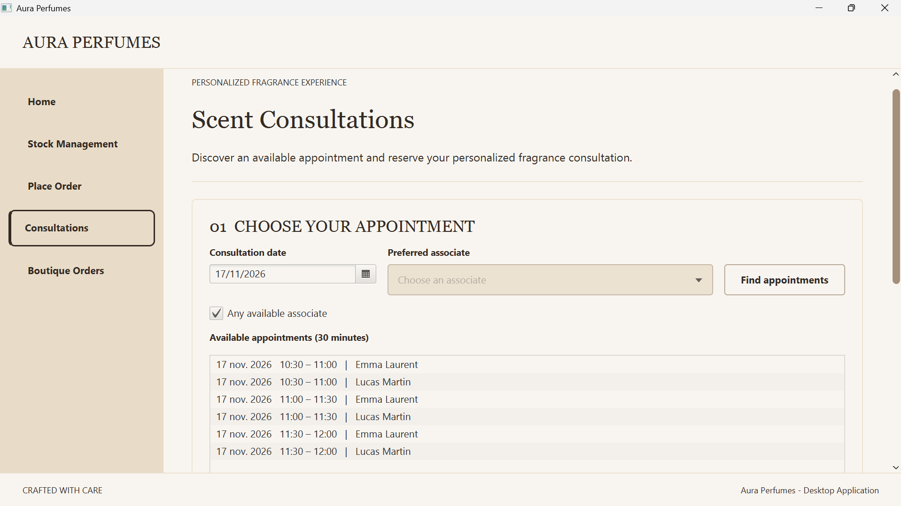
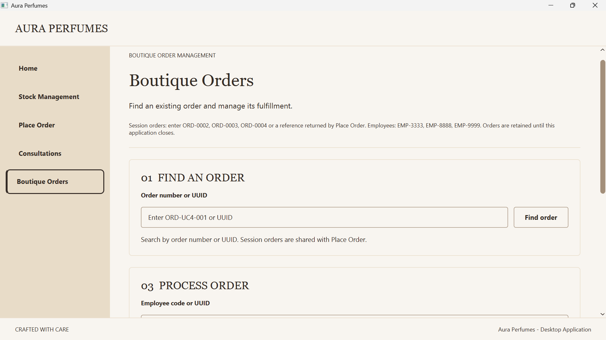

# Aura Perfumes

## Description

Aura Perfumes is a luxury perfume boutique management application developed in **Java 25**, using **JavaFX** for its graphical interface and **Maven** for project management.

The application allows users to manage perfume inventory, place customer orders, redeem loyalty points, book in-store scent consultations, and confirm or process boutique orders.

The project follows **Clean Architecture** principles, separating domain entities, business use cases, repository implementations, and presentation layers.

Its graphical interface features a **Luxury Minimalist** design inspired by high-end perfume boutiques, combining ivory, champagne, taupe, espresso, and gold tones.

## Features

### Main Features

- Product catalog and perfume inventory management
- Stock availability checking and quantity adjustments
- Customer order placement and confirmation
- Shopping cart with quantity modification and item removal
- Loyalty points redemption and discount calculation
- Delivery and in-store pickup options
- In-store scent consultation booking
- Boutique order confirmation and processing
- Shared application state between business use cases

### Stock Management — U1

- Display available products and quantities
- Check product stock availability
- Increase and decrease stock quantities
- Search products and filter by category
- Identify low-stock and out-of-stock products
- Display inventory summary indicators
- Prevent invalid stock adjustments
- Synchronize inventory changes with customer orders

### Place Order — U2

- Browse the product catalog
- Add products to a shopping cart
- Modify quantities and remove products
- Select a customer and view loyalty information
- Redeem loyalty points for discounts
- Preview order totals before confirmation
- Select delivery or in-store pickup
- Confirm orders and generate unique order identifiers
- Automatically update inventory and loyalty balances
- Prevent duplicate submissions and invalid orders

### Scent Consultations — U3

- Browse available consultation slots
- Book in-store scent consultations
- Validate consultation availability
- Prevent duplicate bookings
- Store consultation reservations in SQLite
- Display booking feedback and validation errors
- Simulate consultation email notifications

### Boutique Orders — U4

- Retrieve customer orders created through U2
- Display boutique order information
- Confirm and process orders
- Manage supported order status transitions
- Prevent invalid order operations
- Synchronize order updates with the shared repository

### Interface and UX

- JavaFX desktop graphical interface
- Luxury Minimalist visual design
- Five main navigation screens
- Product catalog and shopping cart interface
- Stock dashboard with summary cards
- Consultation booking interface
- Boutique order management interface
- Responsive desktop layouts with scrollable content
- Form validation and user feedback
- Background processing to maintain UI responsiveness

## Task Distribution

**List of Status :**


### Task 1: Stock Management - U1

In charge : **Evie** _a.k.a_ [@galli](https://github.com/evieg21)

-> Status : 

### Task 2: Place Order and Redeem Points - U2

In charge : **Evie** _a.k.a_ [@galli](https://github.com/evieg21)

-> Status : 

### Task 3: Book In-Store Scent Consultation - U3

In charge : **Maëlys** _a.k.a_ [@badger](https://github.com/mael-bdg)

-> Status : 

### Task 4: Confirm and Process Boutique Order - U4

In charge : **Maëlys** _a.k.a_ [@badger](https://github.com/mael-bdg)

-> Status : 

### Task 5: JavaFX Interface and Design System

In charge : **Evie and Maëlys**

-> Status : 

### Task 6: Application Integration and Testing

In charge : **Evie and Maëlys**

-> Status : 

## Visuals

### Home Screen



### Stock Management - U1



### Place Order - U2



### Scent Consultations - U3



### Boutique Orders - U4



## Language

 => Java 25

 => FXML

 => CSS

 => SQL

## Getting started

### Project Structure

```text
aura-perfumes-website/
├── core/
│   ├── pom.xml
│   └── src/
│       ├── main/java/
│       │   ├── datatransferobjects/
│       │   ├── entities/
│       │   ├── gateways/
│       │   └── usecases/
│       └── test/java/
│
├── services/
│   ├── pom.xml
│   └── src/
│       ├── main/java/
│       │   ├── database/
│       │   ├── notifications/
│       │   ├── repositories/
│       │   └── utils/                   # Reserved package (.gitkeep)
│       └── test/java/
│
├── app/
│   ├── pom.xml
│   └── src/
│       ├── main/
│       │   ├── java/
│       │   │   ├── AuraPerfumesApplication.java  # U1/U2 console application
│       │   │   ├── Main.java                    # U3/U4 console demonstration
│       │   │   ├── application/
│       │   │   ├── controller/
│       │   │   ├── gui/
│       │   │   │   ├── AuraPerfumesFXApplication.java
│       │   │   │   ├── GuiCompositionRoot.java
│       │   │   │   ├── boutique/
│       │   │   │   ├── consultations/
│       │   │   │   ├── navigation/
│       │   │   │   ├── orders/
│       │   │   │   └── stock/
│       │   │   ├── inventory/
│       │   │   ├── presenter/
│       │   │   └── view/
│       │   └── resources/
│       │       └── gui/
│       │           ├── fxml/
│       │           ├── css/
│       │           └── images/          # Reserved assets directory (.gitkeep)
│       └── test/java/
│
├── docs/
├── .gitignore
├── .gitlab-ci.yml
├── pom.xml
└── README.md
```

The application is organized into three Maven modules:

- **core:** Domain entities, business rules, use-case interfaces and contracts.
- **services:** Repository implementations, persistence adapters and supporting services.
- **app:** Application composition, console controllers, presenters and views, JavaFX controllers, read-only inventory adapters and graphical resources.

ProductRepository and StockRepository currently belong to `core/usecases`, while the other repository gateways belong to `core/gateways`.

### Requirements

Before running the project, make sure you have installed:

- Java Development Kit (JDK) 25
- Apache Maven
- Git
- A desktop environment capable of running JavaFX

JavaFX 25.0.2 dependencies and the JavaFX launch plugin are configured in `app/pom.xml`.

SQLite JDBC is supplied by Maven through the services module. The GUI uses SQLite for consultation bookings, associate schedules and employee records.

## Launch

Open a terminal in the project's root directory and run the following commands in order.

### 1. Build the project

```bash
mvn clean install
```

### 2. Launch the graphical interface

```bash
mvn -pl app javafx:run
```

When the application is launched:

- The JavaFX graphical interface opens.
- The welcome screen is displayed.
- The navigation sidebar provides access to the four use cases.
- Demonstration inventory and customer data are initialized.
- Business operations use the application's shared repositories.

### 3. Run automated tests

```bash
mvn clean test
```

**Last verified result:** 288 tests passed, with no failures or skipped tests.

## Usage

### 1. Stock Management

1. Launch the application.
2. Open **Stock Management**.
3. Browse the available inventory.
4. Search or filter products.
5. Select a product.
6. Check its stock or adjust its quantity.
7. Observe the updated inventory indicators.

### 2. Place Order

1. Open **Place Order**.
2. Select products from the catalog.
3. Add them to the shopping cart.
4. Adjust quantities if necessary.
5. Select a customer.
6. Choose the number of loyalty points to redeem.
7. Select delivery or in-store pickup.
8. Preview the order.
9. Confirm the order.
10. View the order confirmation and identifier.

After successful submission, the order is stored with status `PENDING_CONFIRMATION`, stock quantities decrease and loyalty points are redeemed atomically. U4 handles the subsequent order confirmation.

The current demonstration customer starts with 100 loyalty points. The configured demonstration rate is 0.10 per redeemed point. The production conversion rate remains undecided. Cart contents and customer selections are retained during navigation within the same GUI session.

### 3. Scent Consultations

1. Open **Consultations**.
2. Choose a date and an associate, or select any available associate, then use **Find appointments**.
3. Select a suitable slot.
4. Enter the required booking information.
5. Confirm the consultation.
6. View the booking confirmation.

Duplicate or unavailable reservations are rejected.

### 4. Boutique Orders

1. Open **Boutique Orders**.
2. Paste the order UUID returned by **Place Order**, then select **Find order**.
3. Review the order information.
4. Enter an existing employee UUID, choose an action and select **Apply action**.
5. Observe the updated order status.

The existing demonstration sales associate UUID is `33333333-3333-3333-3333-333333333333`. Orders move from `PENDING_CONFIRMATION` to `CONFIRMED`, then `IN_PREPARATION`. In-store pickup orders can then become `READY_FOR_PICKUP` with a nonblank PIN. Cancellation requires an authorized employee, an eligible status and a reason. U4 retrieves individual orders by UUID.

### 5. Example: U1 → U2 → U4 Integration

1. Open Stock Management and check the available stock.
2. Navigate to Place Order.
3. Create and confirm a customer order.
4. Return to Stock Management and verify the quantity decreased.
5. Open Boutique Orders.
6. Paste the newly created order UUID and select **Find order**.
7. Confirm or process the order.

This workflow demonstrates how multiple use cases share application state.

## Architecture

The project follows **Clean Architecture**, separating business logic from infrastructure and presentation concerns.

### Core Layer

Contains domain entities, business rules, use-case interfaces and repository contracts.

### Services Layer

Contains repository implementations, SQLite persistence and supporting infrastructure.

### Application Layer

Contains application initialization, dependency composition, JavaFX controllers and graphical resources.

### Shared Repositories

The graphical interface uses a shared application composition root to provide consistent repository instances across use cases.

`GuiCompositionRoot` supplies the same stock repository to U1 and U2. U2 and U4 use the same in-memory `DatabaseOrderRepository`, implementing both existing order gateway interfaces. `DatabaseOrderTransactionGateway` coordinates the stock, loyalty and order updates with single-JVM atomicity and optimistic version checks. The standalone SQLite `DatabaseBoutiqueOrderRepository` remains available to the legacy console demonstration.

This ensures that:

- Stock changes in U1 are visible to U2.
- Confirmed U2 orders can be retrieved by U4.
- Loyalty balances remain consistent after order confirmation.
- Business operations reuse existing use-case implementations.

## Testing

The project includes automated unit and integration tests covering:

- Domain entities and validation
- Stock synchronization
- Order creation and confirmation
- Shopping cart operations
- Loyalty points redemption
- Consultation booking
- Boutique order processing
- Repository operations
- Cross-use-case integration

The latest local verification recorded the following results.

- 288 tests passed
- 0 failures
- 0 skipped tests
- Successful compilation of all three Maven modules
- Successful JavaFX functional verification

### Continuous integration

The GitLab pipeline in `.gitlab-ci.yml` runs on pushes and merge requests. It compiles the complete project, executes `mvn -B -ntp clean test`, and packages the module JARs. JUnit reports are published even when tests fail, and packaged JARs are retained for one week. Pipeline status and test reports are available under **Build > Pipelines** in GitLab.

## Built with


* [Visual Studio Code](https://code.visualstudio.com) - Code Editor


* [GitLab](https://gitlab.com/) - Git Repository and Version Control


* Java 25 - Programming Language


* JavaFX - Graphical User Interface


* [Apache Maven](https://maven.apache.org/) - Build and Dependency Management


* [SQLite](https://www.sqlite.org/) - Database and Persistence

## Authors and acknowledgment

* **Evie** _a.k.a_ [@galli](https://github.com/evieg21) - U1 Stock Management, U2 Place Order and JavaFX integration.
* **Maëlys** _a.k.a_ [@badger](https://github.com/mael-bdg) - U3 Scent Consultations, U4 Boutique Orders and JavaFX integration.

## Project Limitations
